# Studiu de Impact: Digitalizarea Fluxului de Pontaj

*Analiză Comparativă și Evaluare Beneficii (Pontaj Smart vs. Flux Manual ERP / Hârtie / Email)*

Acest document prezintă analiza de impact privind implementarea aplicației Pontaj Smart în cadrul companiei. Obiectivul principal al aplicației este înlocuirea completă a fluxurilor bazate pe hârtie și email, eficientizarea activității pontatorilor (care operează în ERP) și eliminarea verificărilor manuale duble efectuate în prezent de departamentul de Resurse Umane (HR).

---

## 1️⃣ Fluxul de Lucru: Înainte (Acum) vs. După (Cu Pontaj Smart)

### Fluxul Actual (Înainte)
- 1. Angajatul trimite cererea pe hârtie sau prin email.
- 2. Pontatorul adună manual hârtiile și centralizează emailurile din diverse inbox-uri.
- 3. Pontatorul introduce manual fiecare linie de pontaj și cerere în ERP (interfață greoaie).
- 4. Pontatorul printează centralizatorul fizic pe hârtie din ERP.
- 5. Pontatorul predă pachetul fizic (centralizator + cereri originale) către departamentul HR.
- 6. HR-ul verifică manual fiecare cerere fizică cu centralizatorul printat (verificare dublă pentru erori de tastare).

### Fluxul Propus (După - Cu Pontaj Smart)
- 1. Angajatul cere concediul, pauza sau corecția direct în aplicație (pe mobil sau tabletă).
- 2. Managerul direct primește notificare și aprobă digital cererea în aplicație, printr-un simplu click.
- 3. Pontatorul doar validează pontajul centralizat în aplicație (rol de controlor/supervizor).
- 4. Datele validate sunt transferate automat în ERP direct prin integrare digitală (risc zero de erori de tastare/typo).
- 5. HR-ul doar supervizează rapoartele electronice finale în sistem, fără a mai face verificări manuale duble.

```mermaid
graph TD
    subgraph Acum [Înainte - Flux Manual]
        A[Angajat: Cerere pe hartie/email] --> B[Pontator: Aduna hartiile/emailurile]
        B --> C[Pontator: Operare manuala in ERP]
        C --> D[Pontator: Printare centralizator]
        D --> E[HR: Predare pachet fizic]
        E --> F[HR: Verificare dubla manuala]
    end

    subgraph Viitor [Dupa - Cu Pontaj Smart]
        G[Angajat: Cerere in aplicatie] --> H[Manager: Aprobare digitala]
        H --> I[Pontator: Validare in aplicatie]
        I --> J[Sistem: Transfer automat in ERP]
        J --> K[HR: Supervizare digitala]
    end
```

---

## 2️⃣ Analiză Avantaje și Dezavantaje pe Categorii

### 2.1 Pontatori (Cei care operează în ERP)
- **[Avantaj]** Eliminarea totală a colectării fizice de hârtii și a căutării de date în emailuri.
- **[Avantaj]** Fără operare manuală în ERP (fără tastarea orelor de pornire/oprire sau a concediilor).
- **[Avantaj]** Calcul automat al timpului efectiv de lucru (scăzând automat pauzele neplătite) la nivel de minut.
- **[Avantaj]** Tranziție de la un rol repetitiv de introducere de date la un rol mai valoros de controlor/validator.
- **[Provocare]** Necesitatea adaptării la o nouă platformă web și gestionarea eventualelor necorelări tehnice de sincronizare.

### 2.2 Departamentul Resurse Umane (HR)
- **[Avantaj]** Eliminarea verificării duble. Deoarece transferul de date este automat, riscul de eroare la tastare este zero; nu mai trebuie comparată fiecare hârtie cu ERP-ul.
- **[Avantaj]** Rapoarte de pontaj instantanee, gata calculate și centralizate electronic la sfârșit de lună.
- **[Avantaj]** Eliminarea fizică a dosarelor de concediu și a centralizatoarelor pe hârtie (sustenabilitate și spațiu de arhivare economisit).
- **[Provocare]** Necesitatea ajustării Regulamentului Intern pentru a valida din punct de vedere legal pontajul electronic și semnăturile digitale din aplicație.

### 2.3 Business & Management
- **[Avantaj]** Reducerea masivă a timpului blocat cu închiderea de lună pentru Pontatori și HR (de la zile la ore).
- **[Avantaj]** Măsurarea timpului real lucrat: plata corectă a angajaților pe baza timpului de lucru activ, deducând pauzele neplătite.
- **[Avantaj]** Prevenirea fraudelor de prezență prin validarea automată a locației GPS la pornirea și oprirea programului.
- **[Avantaj]** Economii cu licențele ERP prin utilizarea aplicației Pontaj Smart ca interfață generală.
- **[Provocare]** Asigurarea stabilității integrării tehnice între aplicație și ERP, plus costurile minime de suport IT intern.

### 2.4 Angajați și Manageri de Departament
- **[Avantaj]** Pontaj extrem de simplu (2 secunde pe mobil/tabletă utilizând codul PIN personal).
- **[Avantaj]** Fără cereri scrise de mână sau emailuri; aprobările concediilor se fac printr-un singur click de către manager direct în aplicație.
- **[Avantaj]** Transparență privind orele lucrate, programul planificat și soldul zilelor de concediu.
- **[Provocare]** Necesitatea unei discipline stricte de pontare a pauzelor, pentru a evita înregistrarea unui timp de lucru mai mic decât cel real.
- **[Provocare]** Posibile mici disconforturi inițiale privind solicitarea locației GPS la momentele de clock-in/out.

---

## 3️⃣ Recomandare pentru Implementare

Trecerea la utilizarea exclusivă a aplicației Pontaj Smart va elimina veriga slabă a procesului actual: reconcilierea manuală hârtie-ERP. Se recomandă o perioadă de rulare în paralel de maxim 1 lună pentru a construi încrederea în transferul automat de date, după care cererile fizice și emailurile pot fi eliminate complet. Rezultatul va fi un flux de pontaj eficient, precis și 100% digital.
