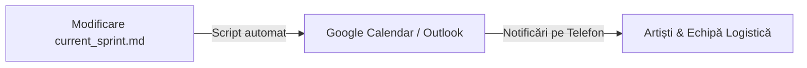

# 🎨 Automatizări Specifice pentru Proiecte Culturale & Evenimente

În proiectele culturale sau în organizarea de evenimente, echipa este adesea formată din **persoane non-tehnice** (artişti, curatori, specialiști PR, coordonatori logistică) care nu folosesc VS Code, Git sau Markdown în mod curent. 

Prin urmare, automatizările pentru un proiect cultural trebuie să fie **simple, accesibile de pe telefon** și integrate cu aplicațiile pe care echipa le folosește deja zilnic (Calendar, Excel, WhatsApp, Teams).

---

## 1. Sincronizarea Automată în Calendarul Echipei (Google Calendar / Outlook)
Aceasta este cea mai utilă automatizare pentru un eveniment. 

* **Cum funcționează:**
  1. Coordonatorul proiectului (Tu) adaugă un jalon sau un task în `current_sprint.md` cu un termen limită:
     `- [ ] **LOG-03**: Închiriere 500 scaune — *Due: 08 Octombrie*`
  2. Un script (Python sau Node.js) citește fișierul și creează automat un eveniment de tip **"Reminder/Task"** în Google Calendarul comun al echipei.
  3. Responsabilul (Andrei) primește o notificare automată pe telefon cu 24h înainte de termenul limită.
* **De ce este util:** Echipa nu trebuie să verifice fișierele de proiect; își deschid doar aplicația de calendar de pe telefon.

---

## 2. Actualizarea Task-urilor dintr-un Google Sheet (Excel Partajat)
Deoarece managerii culturali și coordonatorii de logistică iubesc Excel-ul, putem construi un canal bidirecțional:

1. Echipa completează sarcinile într-un **Google Sheet partajat** (unde au coloane simple: Sarcina, Responsabil, Termen, Status - *De făcut, În curs, Realizat*).
2. Un script simplu rulează în fundal (folosind Google Apps Script) și **scrie/actualizează automat** fișierele Markdown `backlog.md` și `current_sprint.md` din spațiul dvs. de lucru.
* **De ce este util:** Tu poți urmări proiectul în stilul tău de programator (în Markdown, curat), iar echipa colaborează într-o interfață familiară lor (Excel online).

---

## 3. Notificări în Timp Real pe Teams sau WhatsApp
Când se întâmplă evenimente importante sau se depășesc termene:

* **Sarcini finalizate:** Când un task de logistică important este bifat ca `Done` în Excel/Markdown (ex: *„S-a obținut autorizația de la Primărie”*), un bot trimite un mesaj festiv pe grupul de Teams sau pe grupul de WhatsApp al echipei:
  > *„🎉 Vești bune! **Andrei** a obținut autorizația pentru concert! Suntem oficial autorizați! 🏛️”*
* **Alerte de întârziere:** Dacă un task depășește data de `Due Date` și nu este marcat cu `[x]`, sistemul trimite o alertă discretă pe chat responsabilului:
  > *„Salut **Andrei**, amintește-ți că termenul limită pentru închirierea scenei (`LOG-01`) a fost ieri. Ai nevoie de ajutor?”*

---

## 4. Integrarea Bugetului în Planul de Proiect
Bugetul este inima oricărui proiect cultural.

* **Cum funcționează:**
  1. Ai un tabel în Excel cu cheltuielile reale (scenă, sunet, onorarii, promovare).
  2. Un script citește datele financiare și le injectează în fișierul `backlog.md` sau într-un dashboard local.
  3. Calculează automat indicatori vizuali în document:
     * **Buget Total:** 10.000 €
     * **Cheltuit:** 6.500 € (**65%**)
     * **Fonduri rămase:** 3.500 € (Afișat cu verde dacă suntem în grafic, sau cu roșu dacă depășim estimările).
