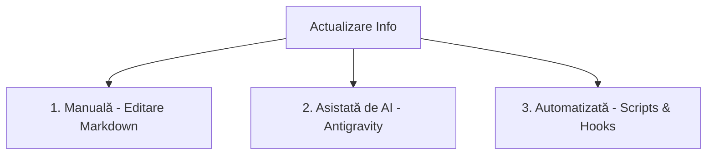

# ⚡ Ghid de Actualizare & Automatizări în Project Management

Pentru a evita efortul manual repetitiv (redactarea fișierelor `.md` de task-uri), putem folosi diverse metode de actualizare și scripturi de automatizare care conectează activitatea de zi cu zi direct cu planul de proiect.

---

## 1. Cum actualizăm informațiile (3 Metode)

### A. Manual (Editare Directă)
Deschideți [current_sprint.md](file:///c:/Projects/PontajSmart/tasks/current_sprint.md) în VS Code și modificați textul direct. Folosiți `Ctrl + Shift + V` pentru a vizualiza panoul Kanban.

### B. Asistat de AI (Prin Antigravity Chat)
Puteți folosi limbajul natural direct în chat-ul cu mine pentru a edita fișierele de sarcini.
* *Exemple de comenzi pe care mi le puteți da:*
  * *„Pune task-ul LOG-01 în In Progress și pune-l pe Andrei ca responsabil.”*
  * *„Adaugă un nou jalon pentru data de 20 Septembrie: 'Lansare website public'.”*
  * *„Marchează sarcina MKT-01 ca finalizată și pune data de azi.”*

### C. Sincronizare automată bazată pe cod (Git Hooks)
Dacă proiectul este software, putem scrie un script local (Git Hook) care rulează de fiecare dată când dați `git commit`. Dacă mesajul commit-ului conține textul `[RESOLVES AUTH-101]`, scriptul va citi automat `current_sprint.md` și va muta sarcina `AUTH-101` la secțiunea `Done` (Realizat), punând bifa `[x]` automat!

---

## 2. Ce Automatizări putem implementa?

Iată cele mai bune idei de automatizări practice care pot fi construite:

### 📅 A. Integrare automată cu Outlook / Google Calendar
Putem scrie un mic script în Python sau Node.js care:
1. Citește fișierele `backlog.md` și `current_sprint.md`.
2. Extrage toate jaloanele (Milestones) și sarcinile care au un termen limită (`Due: AAAA-LL-ZZ`).
3. Apelează API-ul Google Calendar sau Microsoft Outlook și adaugă sau actualizează automat evenimente/reminder-e în calendarul comun al echipei.
* **Beneficiu:** Echipa vede termenele limită direct pe telefon, în calendar, fără să deschidă proiectul.

### 📬 B. Notificări Automate pe MS Teams (Webhooks)
Putem conecta fișierele de task-uri cu MS Teams:
1. Când o sarcină este mutată în coloana `Done` sau `In Review` (detecție prin script sau git commit).
2. Un webhook trimite o notificare frumoasă, colorată, pe canalul de Teams al echipei (ex: *„Ioana a finalizat task-ul MKT-01 (Design Afiș)! 🎨”*).
* **Beneficiu:** Toată lumea din companie este la curent în timp real cu progresul proiectului.

### 📊 C. Generator de Dashboard Vizual (Gantt Chart & Progress)
Putem crea un script local care generează o pagină web statică (`dashboard.html`) citind datele din `.md`:
* Scriptul calculează procentul de completare (ex: *12 din 15 sarcini finalizate = 80%*).
* Desenează un grafic **Gantt** (cronograma vizuală a sarcinilor) și un grafic de **Burn-down** (cât de repede termină echipa sarcinile față de termenul limită).
* **Beneficiu:** Poate fi trimis conducerii ca raport vizual rapid printr-un singur click.

### 📝 D. Export automatizat de Raport DOCX
Putem scrie un script similar cu cel folosit la documentele noastre care transformă `current_sprint.md` într-un document Word oficial cu logo-ul companiei și antet profesional, pregătit pentru a fi printat sau semnat.
