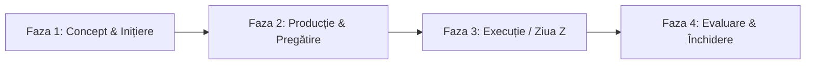

# 🎨 Metodologia de Management pentru Proiecte Generale & Culturale

Proiectele generale (cum ar fi evenimentele culturale, festivalurile, expozițiile, lansările de carte sau piesele de teatru) au o dinamică diferită față de proiectele software. Acestea au un **termen limită fix (ziua evenimentului)** care nu poate fi amânat și depind foarte mult de logistică, parteneri externi și bugete stricte.

Pentru aceste proiecte, cea mai potrivită metodologie este una **Hibridă**: combină **Abordarea Tradițională (Waterfall)** pentru planificarea etapelor cronologice cu **Abordarea Vizuală (Kanban)** pentru urmărirea activităților zilnice.

---

## 1. Structura Cronologică a unui Proiect Cultural (Fazele Proiectului)

Un proiect cultural se desfășoară în 4 faze liniare distincte:

### Faza 1: Inițiere și Planificare (Concept)
* **Ce se face:** Definirea temei, stabilirea bugetului estimativ, scrierea proiectului pentru finanțări/sponsorizări, obținerea autorizațiilor inițiale.
* **Jalon (Milestone) cheie:** *Buget aprobat și parteneri principali confirmați.*

### Faza 2: Pregătire și Producție (Pre-producție)
* **Ce se face:** Rezervarea spațiului/locației, contractarea artiștilor/furnizorilor, campania de promovare (Social Media, presă, afișe), achiziția de materiale necesare.
* **Jalon (Milestone) cheie:** *Bilete puse în vânzare / Promovare lansată.*

### Faza 3: Execuție (Evenimentul / Ziua Z)
* **Ce se face:** Amenajarea spațiului, probe de sunet/lumină, primirea publicului/invitaților, desfășurarea activităților artistice, coordonarea echipei la fața locului.
* **Jalon (Milestone) cheie:** *Desfășurarea cu succes a evenimentului.*

### Faza 4: Evaluare & Închidere (Post-producție)
* **Ce se face:** Strângerea echipamentelor/decorului, efectuarea plăților finale către furnizori/artiști, redactarea raportului financiar și de activitate (justificarea fondurilor), strângerea de feedback.
* **Jalon (Milestone) cheie:** *Raport final depus și proiect închis.*

---

## 2. Organizarea Sarciniilor: Structura WBS (Work Breakdown Structure)

În proiectele culturale, sarcinile nu se împart pe tehnologii, ci pe **arii de responsabilitate (departamente)**. Acest lucru se numește WBS:

1. **Aria Artistică & Program:** Contractare artiști, stabilire program/orar (line-up), scenariu, drepturi de autor.
2. **Logistcă & Tehnic:** Închiriere sală, echipamente sunet/lumini, cazare/masă artiști, transport, amenajare spațiu.
3. **Marketing & PR:** Design afișe, campanie online, comunicate de presă, invitații, gestionare rețele sociale.
4. **Financiar & Administrativ:** Contractare, bugete, plăți, vânzare bilete, securitate/pază, curățenie.

---

## 3. Adaptarea Panoului Kanban pentru Evenimente

Spre deosebire de IT, unde folosim "Story Points", în proiectele culturale folosim **Termene Limită (Due Dates)** stricte și **Responsabili Clari**.

### Coloanele panoului Kanban adaptat:
* **`📥 Idei / Backlog`**: Idei de artiști, propuneri de locații, schițe de promovare.
* **`📝 De Făcut (To Do)`**: Sarcini alocate care trebuie începute (ex: *„Trimite contractul către Artistul X”*).
* **`⏳ În Curs (In Progress)`**: Activități pornite (ex: *„Se printează afișele”*).
* **`🔍 În Așteptare (Blocked / Pending)`**: Sarcini care depind de un factor extern (ex: *„Așteptăm confirmare primărie pentru autorizația de zgomot”*).
* **`✅ Realizat (Done)`**: Sarcini finalizate (ex: *„Avansul pentru sală a fost plătit”*).

---

## 4. Exemplu Practic: Organizarea unei Expoziții de Artă Contemporană

Iată cum ar arăta fișierul de project management pentru acest proiect cultural:

### 📅 Jaloane (Milestones) Proiect
- [x] Concept aprobat și artiști selectați (2026-09-05)
- [ ] Contracte de locație și parteneriate semnate (2026-09-15)
- [ ] Lucrări de artă recepționate și asigurate (2026-10-01)
- [ ] Vernisajul expoziției - Ziua Evenimentului (2026-10-10)
- [ ] Raport final de activitate și deconturi închise (2026-10-25)

### 📋 Kanban Board
#### 📝 De Făcut (To Do)
- [ ] **PR-02**: Trimite comunicatul de presă oficial către publicațiile culturale — *Responsabil: Ioana (Marketing)* — *Due: 2026-09-20*
- [ ] **LOG-05**: Achiziție vin și catering pentru seara vernisajului — *Responsabil: Andrei (Logistică)* — *Due: 2026-10-05*

#### ⏳ În Curs (In Progress)
- [ ] **LOG-02**: Închiriere panouri expoziționale suplimentare și spoturi luminoase — *Responsabil: Andrei (Logistică)* — *Due: 2026-09-12*
- [ ] **ART-03**: Coordonarea transportului securizat pentru tablouri din alte orașe — *Responsabil: Curatorul* — *Due: 2026-09-28*

#### 🔍 În Așteptare (Blocked)
- [ ] **ADM-02**: Autorizație de securitate fizică din partea spațiului gazdă — *Responsabil: Mihai (Admin)* — *Așteaptă: Răspuns de la managerul spațiului.*

#### ✅ Realizat (Done)
- [x] **ART-01**: Selectarea celor 15 artiști participanți și stabilirea catalogului de lucrări — *Finalizat la 2026-09-04*
- [x] **ADM-01**: Semnarea acordului principal cu galeria de artă — *Finalizat la 2026-09-02*
