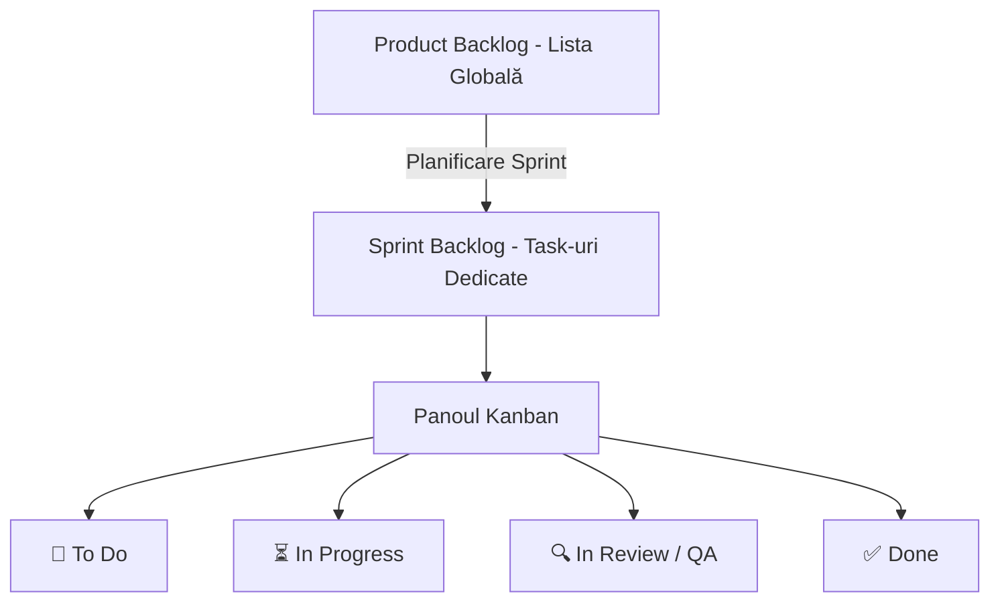

# 📖 Metodologia Agile Scrum/Kanban: Ghid Practic de Învățare

Acest ghid detaliază metodologia de management de proiect aplicată în dezvoltarea proiectelor noastre (**Pontaj Smart** și **Campanii Inteligente**). Aceasta combină elemente de **Scrum** (structură, sprinturi, roluri) cu **Kanban** (flexibilitate vizuală și limitarea lucrului în desfășurare).

---

## 1. Concepte de Bază (Terminologie)

### A. Epice (Epics)
Un **Epic** este o colecție mare de sarcini de lucru care împart același obiectiv principal de business.
* *Exemplu:* `🔐 Epic 1: Auth & User Sychronization` sau `🎨 Epic 2: UI/UX & Styling Refinements`.
* *Scop:* Ajută la gruparea logică a codului pe module (ex: Securitate, Interfață, Concedii).

### B. Task-uri / User Stories (Sarcini de lucru)
Sunt unități mici, independente și testabile de funcționalitate care aduc valoare utilizatorului. Fiecare are un ID unic.
* *Exemplu:* `AUTH-101`: Autentificare PIN prin REST API.
* *ID Format:* `[COD-MODUL]-[NUMĂR]` (ex: `GEST-101`, `LV-301`).

### C. Product Backlog
O listă unică, ordonată după prioritate, care conține toate funcționalitățile viitoare, erorile de reparat (bugs) și sarcinile tehnice (refactoring). Backlog-ul este o **entitate vie**, ceea ce înseamnă că sarcini noi pot fi adăugate oricând.
* *Locație:* [tasks/backlog.md](file:///c:/Projects/PontajSmart/tasks/backlog.md)

---

## 2. Rularea unui Sprint (Ciclul de Dezvoltare)

Dezvoltarea nu se face haotic, ci în cicluri numite **Sprinturi**.
* **Durată standard:** 2 săptămâni.
* **Sprint Goal:** Un obiectiv clar stabilit la începutul sprintului (ex: *"Să integrăm BioeelAuth și să stilizăm sidebar-ul"*).
* **Sprint Capacity:** Numărul maxim de puncte pe care echipa le poate finaliza în 2 săptămâni (ex: 20-25 puncte).

### Panoul Kanban (Sprint Board)
Sarciniile trec prin următoarele stări vizuale în [current_sprint.md](file:///c:/Projects/PontajSmart/tasks/current_sprint.md):

1. **`📝 To Do`**: Sarcini programate pentru sprintul curent, dar care nu au fost începute.
2. **`⏳ In Progress`**: Sarcini la care se scrie cod activ în acest moment.
3. **`🔍 In Review / QA`**: Codul a fost scris, dar este în curs de testare locală, compilare (`npm run build`) sau revizuire.
4. **`✅ Done`**: Sarcini finalizate care îndeplinesc criteriile de calitate și sunt live în producție.

---

## 3. Estimarea Efortului: Story Points (Puncte de Poveste)

În loc de a estima în ore (care pot fi înșelătoare), în Agile estimăm în **Story Points** pe o scală bazată pe **șirul lui Fibonacci**: `1, 2, 3, 5, 8, 13`.
Punctele măsoară trei lucruri simultan: **Complexitatea**, **Volumul de muncă** și **Riscul/Incertitudinea**.

| Puncte | Semnificație | Exemplu de task |
| :--- | :--- | :--- |
| **1 - 2 pts** | **Task foarte simplu:** Modificări minore de text, stilizări simple de CSS, modificarea unei variabile de configurare. | Schimbarea aspectului profilului din sidebar (`UI-201`). |
| **3 pts** | **Task mediu standard:** Crearea unei noi pagini statice, adăugarea unei metode simple în frontend sau a unui tabel de date. | Crearea butonului și a logicii vizuale de sync manual. |
| **5 pts** | **Task complex:** Funcționalitate cap-la-cap. Necesită modificări pe frontend, API Node.js backend și tabele din baza de date SQL. | Logarea asincronă cu cod PIN securizat (`AUTH-101`). |
| **8 pts** | **Task foarte complex:** Are risc ridicat, necesită cercetare (R&D) și integrări de sisteme externe noi. | Algoritmi de potrivire semantică prin AI sau procesare OCR facturi. |
| **13+ pts** | **Prea mare:** Task-ul este un "monolit" și trebuie spart în task-uri mai mici de 3, 5 sau 8 puncte. | Reconstruirea completă a bazei de date. |

---

## 4. Definition of Done (DoD) - Definiția Finalizării

Un task **NU** poate fi mutat în coloana `✅ Done` doar pentru că dezvoltatorul „a terminat de scris codul”. El trebuie să îndeplinească următoarele criterii stricte (DoD):

- [x] **Calitatea Codului:** Codul este curat, nu conține console.log-uri inutile și respectă TypeScript (fără erori de compilare).
- [x] **Compilare Producție:** S-a rulat `npm run build` local și compilarea a reușit cu cod de succes 0.
- [x] **Testare & QA:** Funcționalitatea a fost testată manual în browser și funcționează conform cerințelor.
- [x] **Deployment:** Codul a fost copiat în producție pe serverul partajat (`\\be-apl01\Apps`).
- [x] **Activare Backend:** Bridge-ul Node.js a fost repornit pe server (`start_pontaj.bat`) și rulează fără erori.
